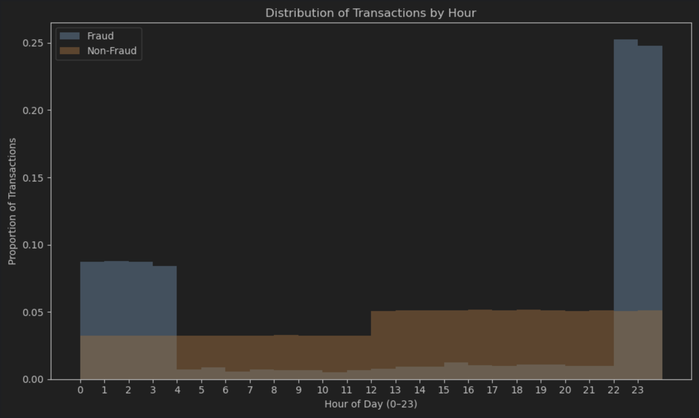
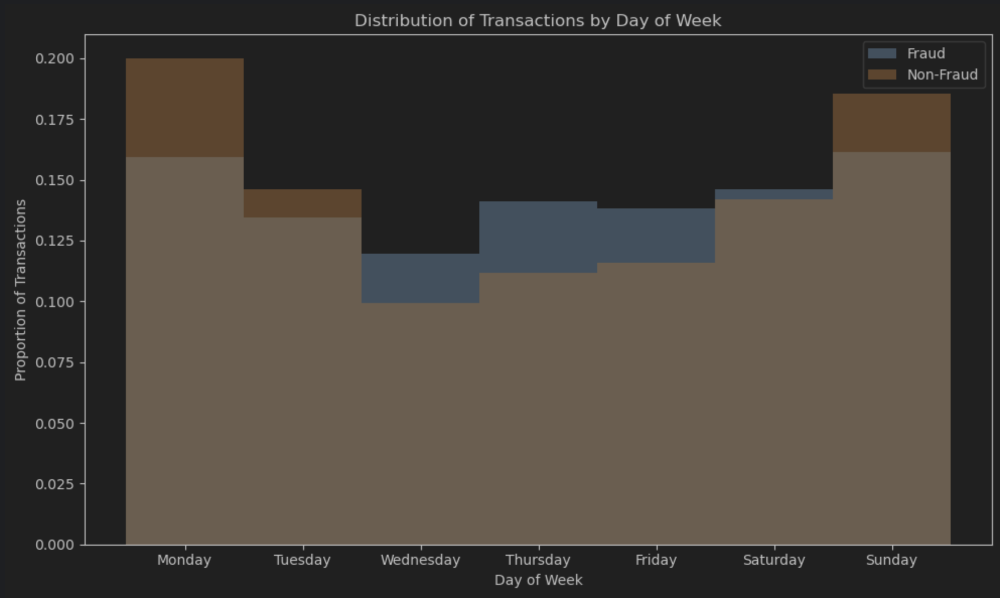
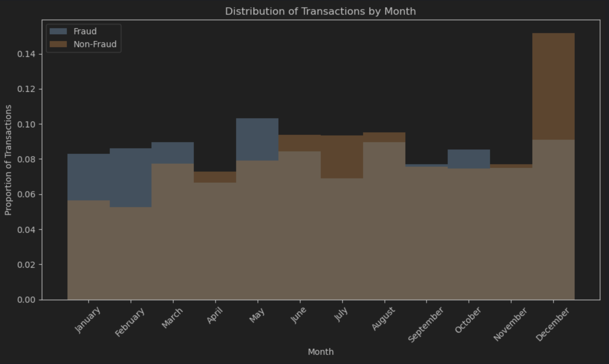
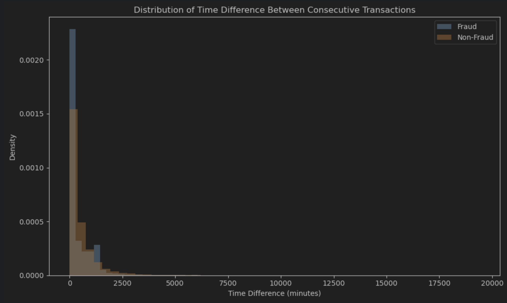
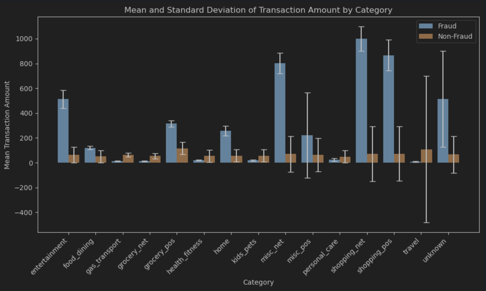
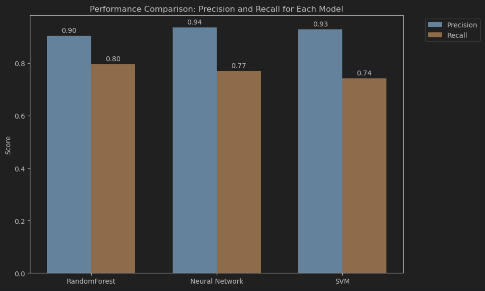
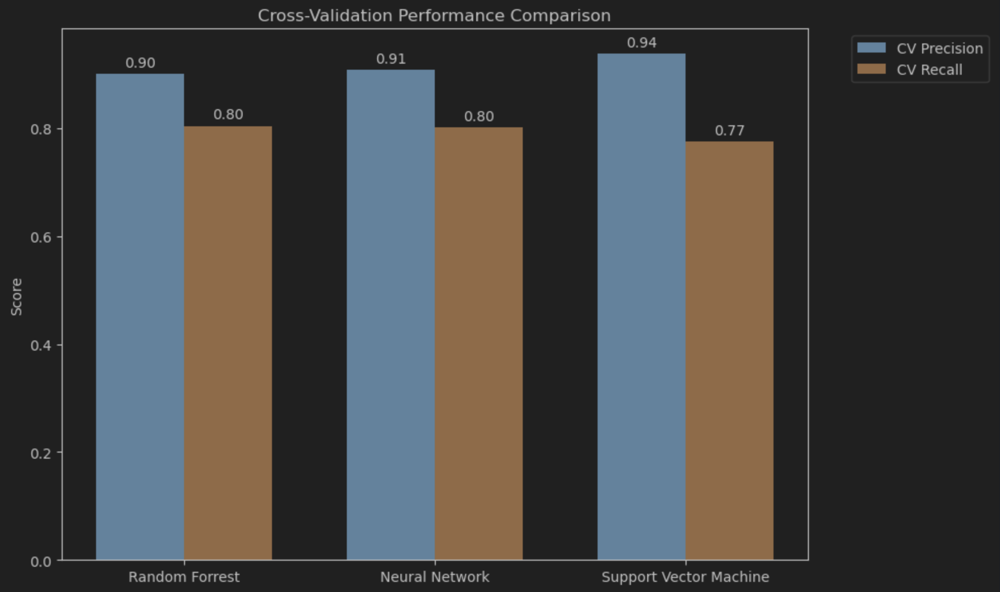
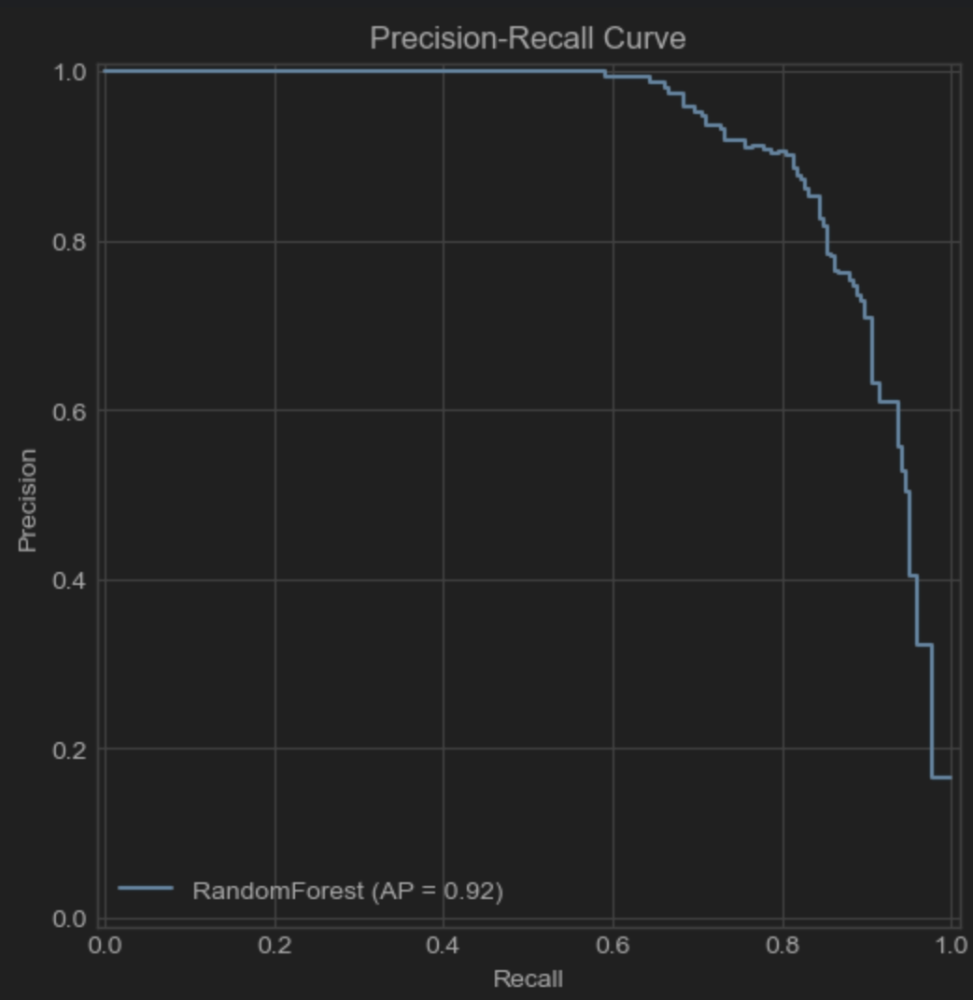
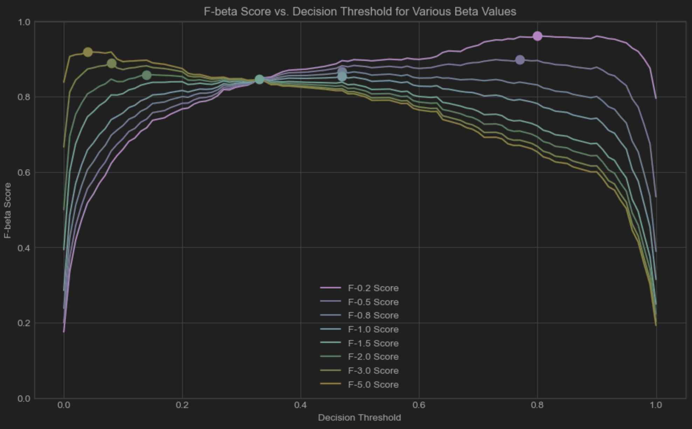
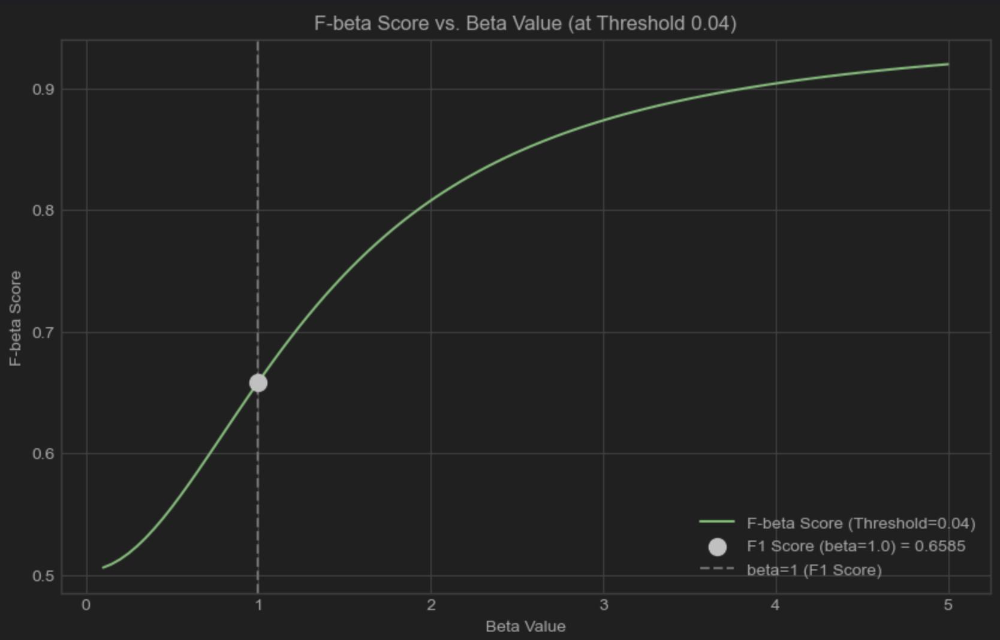

# System Report

## System Description

The SecureBank Fraud Detection System v2 Prototype is a machine learning based system
designed to identify potentially fraudulent credit card transactions in near real time.
It serves as a replacement for SecureBank's previous detection System, which suffered from
deteriorating performance. The primary goal of this redesigned system is to significantly
 improve the accuracy, specifically precision and recall of fraud identification, thereby
reducing financial losses for SecureBank and minimizing disruption to legitimate customer
transactions.

The system is built around three core components Data Handling, Modeling, and API Service Layer.
In Data Handling, it is responsible for the end-to-end preparation of data used for both training 
and evaluation models. It ingests raw data from multiple sources, customer information CSV, transaction,
transaction Parquet file, and fraud label JSON, merges them, cleans the data, and performs important feature 
engineering. The Modeling is based on initial comparative analysis of several algorithms Randoms Forrest,
Neural Networks, and Support Vector Machine. The Random Forrest algorithm demonstrated the most promising performance
on the prepared data. A dedicated `RandomForrestModel class` encapsulates the scikit-learn model, standardizing the processes 
for training, prediction, and model serialization. This allows for consistent model handling and facilitates versioning. The system 
exposes its core functionalities via a RESTful API built using Flask. This allows for integration with other SecureBank systems.
Key parts include `/predict`,`/create_dataset` and `/train_model`. The `/predict` is a POST accepts single transaction data in JSON
format, preprocesses it using logic consistent `RawDataHandle` and returns a prediction "legitimate" or "fraudulent" using a loaded,
pre-trained model. The `/create_dataset` is a POST which trigger the full `RawDataHandle` pipeline on demand, generating fresh, timestamped 
training and testing datasets from the latest source data. Lastly the `/train_model` is a POST that initiate the training of new
Random Forrest model using a specified training dataset and save the resulting trained model with a unique, timestamped identifier for
versioning.

The system incorporates detaied JSON-based logging for all API interactions and significant internal events. Logs are stored in 
timestaped files, capturing request data, responses, errors, and timing information to facilitate monitoring and auditing.

## Data Analysis

A fundamental requirement is that the system's design must be informed by thorough analysis of the provided historical transaction data.
This analysis aims to uncover patterns distinguishing fraudulent from legitimate transactions and identify predictive features.

### Transaction Hour Distribution

The distribution of transactions throughout the 24-hour cycle was analyzed separately for know fraudulent and non-fraudulent activities,
using the `hour` component extracted from the `trans_data_trans_time` feature.

The analysis, visually represented in the accompanying plot, revealed a striking difference between the two classes. Fraudulent
transactions demonstrate a significantly higher frequency during late-night and early-morning hours, specifically showing sharp 
peaks between 00:00–3:00 and again between 22:00–23:00. In contrast, non-fraudulent transactions are distributed more uniformly
throughout the day, with moderate peaks during typical waking/business hours. This pronounced divergence in hourly patterns strongly
indicates that the time of day is a significant predictor of fraud risk. Transactions occur during late-night hours are disproportionately
more likely to the fraudulent according to the historical data. Therefore, a key requirement derived from this analysis is that the system 
must utilize the transaction hour as an input feature for its predictive modeling to capture this critical temporal pattern. This finding 
also directly informs subsequent feature engineering requirements.

### Transaction Day of Week Distribution

The relative proportion of fraudulent and non-fraudulent transactions was examined for each day of the week, derived from the 
`trans_data_trans_time` feature.

As illustrated in the corresponding plot, the analysis shows that the ratio of fraud to non-fraud transactions varies across the week.
Fraudulent transactions constitute a proportionally large share of activity mid-week observed notably on Wednesday, Thursday, and Friday, while
non-fraudulent transactions are relatively more dominant at the beginning Monday, Tuesday, and end Sunday of the week. The finding that 
the likelihood of transaction being fraudulent differs depending on the day of the week implies that `day_of_week` contains valuable predictive 
information. Including this allows the model to potentially capture weekly behavioral patterns associated with fraud. Consequently, the analysis
requires that the day of the week be incorporated as a feature input to the model.

#### Transaction Month Distribution

The proportion of fraudulent vs. non-fraudulent transactions was analyzed across the twelve months of the year, based on the `trans_data_trans_time`
feature.

The data reveals a distinct seasonal pattern in the relative prevalence of fraud, as depicted in the plot. Months early in the year
January – May, with specific peaks noted in the plot exhibiting a relatively higher proportion of fraudulent transactions compared to the overall
volume. Conversely, later months June – December, particularly the last quarter, show a lower proportion of fraud, even in months with high total 
transaction volume like December. This clear seasonal variation indicates that the `month` of a transaction provides a relevant signal regarding its
likelihood of being fraudulent. The model can leverage this critical, year-long trend to improve its predictive accuracy. Therefore, using the month
of the transaction as a feature is identified as a system requirement based on its demonstrated correlation with a fraud likelihood across the calendar year.

### Transaction Occurring in Quick Succession

The time difference between consecutive transactions for the same customer we calculated and its distribution analyzed separatly for fraudulent and non-fraudulent
transactions.

The analysis revealed a significant behavioral difference, as indicated by the distribution histogram. Fraudulent transactions show a markedly higher density at
very small time differences, often close to zero minutes, suggesting that fraudulent activity frequently occurs in rapid bursts or quick succession using the same
cardholder's information. While non-fraudulent transactions can also occur relatively closely together, their distribution is more spread out over
time compared to the sharp near zero observed for fraud. This distribution pattern related to transaction velocity provides a strong predictive 
signal. A very short time elapsed since a customer's last transaction is a notable indicator potentially increasing the likelihood of the current 
transaction being fraudulent. Capturing this dynamic behavior is important for effective fraud detection. Therefore, the analysis strongly justifies 
the requirement to calculate and includes the time difference since the customer's previous transaction as a key input feature for he predictive model.

### Transaction Amount by Purchase Category

For each purchase `category`, we calculated the mean and standard deviation of transaction amount for fraudulent and 
non-fraudulent transactions. We used the values to plot the probability distribution function over a histogram of 
the actual transaction amount distribution to see how well the data actually fit a normal distribution.

In many purchase categories, the overlaid normal Probability Distribution Function (PDF) generally captures the central tendency of the observed transaction amount. 
This suggests that, at least in the central region, the mean and standard deviation are reasonable summaries of the data. However, some 
categories exhibit deviations in the tails or display noticeable skewness, indicating that the normal approximation isn't perfect 
in every case. Across multiple categories, the histograms reveal district difference between fraudulent and non-fraudulent 
transactions. For instance, in some categories, fraudulent transactions tend to have either a lower or higher mean compared 
to their non-fraudulent counterparts. In other cases, the spread is noticeably different, hinting at more variability in the 
fraudulent group. This differential behavior suggests that purchase category specific transaction amount profiles could serve 
as useful discriminators in the fraud detection model.

The observed differences in a central tendency and variability between fraud and non-fraud within each category provide a strong 
indication that transaction amount statistics are informative. For example, if fraudulent transactions in a particular 
category consistently occur at amounts well below or above the category's average, that signal can help the model learn 
which transactions deviate from expected behavior. The fact that some categories do not fit the normal distribution perfectly 
evidenced by heavier tails or skew implies that relying solely on mean and standard deviation might miss extreme values. 
These outliers could be particularly relevant for detecting fraud, so additional features like z-scores might be beneficial.

The plot bars represent the average transaction amount for a specific purchase category. This gives a baseline expectation 
of what constitutes a typical transaction in that category. The error bars indicate the standard deviation for each category. 
They reflect the variability or spread of transaction amount. A large error bar means that the transactions in that category 
are more spread out, whereas a smaller error bar indicates a tighter clustering around the mean.

Some categories exhibit higher average transaction amount while others are lower. For example, categories like `shopping_net` or `travel` 
might show higher means, indicating that purchases in these areas are generally more expensive. In contrast, categories like 
`grocery_pos` or `food_dining` may have lower mean values, which aligns with everyday spending. The standard deviation varies 
significantly among categories. Categories with high standard deviations suggest that there is a wide range of transaction amounts. 
This variability might indicate that within a single category, there are both small and huge transactions. Such variability 
could be a signal for potential anomalies or outliers transactions that deviate significantly from the norm might be worth 
further investigation. Categories with low standard deviations show more consistent transaction amount. In these categories, 
a transaction that fall far from the mean could be a strong indicator of unusual activity fraud.

These findings demonstrate that both rge transaction `amt` and the purchase `category` are crucial interacting features. The 
normalcy or suspiciousness of a transaction amount cannot be judged in isolation; it is highly dependent on the context provided
by the purchase category. The observed statistical differences in mean and standard deviation between fraud and non-fraud
within categories provide a strong signal for the model. For instance, a transaction amount for from the typical mean for 
the model. For instance, a transaction amount far from the typical mean for its category could indicate fraud. Therefore, it
is a requirement that the system must use both `amt` and `category` features, and it must be able to evaluate the amount
relative to its category's specific statistical profile.

## Feature Engineering

Following the Data Analysis, specific feature engineering techniques were applied to transform raw data and analysis 
insights into a format suitable for the machine learning model, aiming to enhance its ability to detect fraudulent patterns.
The requirements for these engineered features stem directly from the patterns identified previously.

### Time Based Feature Engineering

It captures the distinct high-risk periods identified in the hourly analysis and the cyclical nature of monthly and weekly patterns.

The transaction `hour` was binned into categorical segments `late_night` for 22:00–03:00, `daytime` otherwise. This directly encodes
the high-risk versus low-risk periods identified in the analysis, simplifying the pattern for the model. This nominal feature was
the One-Hot Encoded using, creating numerical features for both segments `time_segment_daytime` and `time_segment_night`.
While this introduces perfect multicollinearity, tree-based models like the chosen Random Forrest are generally robust to it.

To correctly represent the cyclical nature of months when December is close to January, the numerical `month_num` 1-12 was 
transformed using sine and cosine functions `month_sin = sin(2 * pi * month / 12), month_cos = cos(2 * pi * month / 12)`. This
technique embeds the months onto a circle, preserving the proximity between month 12 and 1, allowing the model to better 
learn seasonal patterns identified in the analysis.

The category `day_of_week` feature was One-Hot Encoded. This converts each day into its own binary feature, treating them
as distinct categories without imposing a false ordinal relationship. Using `drop_first=False` retains all categories and while
technically introducing multicollinearity, this is often handled well by tree-based algorithms like Random Forrest.

### Transaction Velocity Feature Engineering

Quantify the observed pattern that fraudulent transactions often occur in rapid succession. The time elapsed since the 
 previous transaction by the same customer `time_diff` was calculated in minutes. This directly measures transaction 
velocity per customer. The distribution of `time_diff` was observed to be highly right-skewed (many small values). A log
transformation `log_time_diff = log(time_diff + 1)` was applied. This common technique compresses the range of large time
 differences and expands the range of small differences, making the distribution more symmetric, stabilizing variance and
potentially improving model performance by making the feature's influence less sensitive to extreme large values. The plus 1
avoids issues with log(0).

### Contextual Amount Feature Engineering

Evaluate transaction amount relative to typical spending within their specific purchase category, as justified by the 
analysis showing category-dependent amount statistics differ between fraud and non-fraud. The Z-score for each amount
was calculated relative to the mean and standard deviation of mount specific `category` `amt_zscore = (amt - category_mean) / category_std`.
This technique normalized the amount based on its context, providing a standardized measure of how unusual, how many standard
deviations away from the mean an amount is for that particular category. This directly incorporates the analytical finding 
that normal amount vary greatly by category and helps the model identify contextual outliers that might indicate fraud more
effectively than using the raw amount alone. Logic was included to handle categories with zero standard deviation.

## Partitioning

A robust data partitioning strategy is essential for accurately evaluating the performance of a fraud detection model and
ensuring it generalizes well ot real-world conditions. Simple random splitting is often inadequate for time-series data
like financial transactions, as it can lead to data leakage and overly optimistic performance estimates.

 ### Chosen Strategy

The system employs a rigorous partitioning strategy implemented within the `RawDataHandler`'s `partition_by_customer_and_time`
logic. This strategy combines two critical dimensions. One of them is the customer level split where the entire pool of
customers is divided into district training sets before any transaction data is assigned. This ensures that no customer who
appears in the training set also appears in the test set. The proportion of customers assigned to testing is configurable.
The second is temporal split a chronological cutoff point is established based on the training timestamps `trans_data_tran_time`,
typically using a quantile. Transaction data associated with customers in the training group is filtered to include only 
records before this cutoff time. Conversely, data for customers in the testing group is filtered to include only records
at or after the cutoff time.

### Justification for Strategy

Partitioning by customer forces the model to learn generalized fraud patterns rather than simply memorizing the specific 
spending habits or fraud history of individual customers present in the training data. This provides a far more realistic
assessment of how the model will perform when encountering transactions from new customers it has never seen before as 
a critical requirement for any real-word banking application. Fraud transaction evolves constantly. Training the model exclusively
on past data and evaluating it on later future data directly simulates the real-world deployment scenario where the model
must predict outcomes for transactions occurring after its training period. This out-of-time validation helps assess the
model's ability to handle potential shifts in data distribution and emerging fraud patterns over time, preventing overly
optimistic results that could arise if the model had access to future information during training. The combination of these
two splits provides the most robust evaluation framework, simultaneously testing the model's ability to generalize across
unseen customers and future time periods.

### Ensuring Dataset Quality

The `RawDataHandler` ensures that all data undergoes the exact same cleaning, preprocessing, and feature an engineering 
pipeline before the partitioning logic is applied. This guarantees consistency in data structure and feature representation
across potential training and testing sets. The core design split separating customers entirely, and using strict time cutoff
inherently prevents leakage of future information or test customer behavior into the training set. Within the final step,
when sampling non-fraudulent records to handle class imbalance, the sampling is performed randomly within the already defined
training and testing partitions. This helps maintain a degree of representativeness for the non-fraudulent class within
each set. The partitioning process incorporates options for setting a `random_state` during the initial customer split,
allowing for reproducible dataset generation for consistent experimentation. The generated dataset files are also timestamped,
aiding traceability.

## Model Selection

This section details the selection, evaluation, and justification of the machine learning models considered for the SecureBank
fraud detection system. The goal is to select a model that not only performs well statistically but also aligns with the 
business goal of minimizing fraud losses while maintaining a positive customer experience.

Several machine learning models suitable for binary classification on tabular data were evaluated to ensure a robust comparison.
We evaluated Random Forest, a Neural Network with 50 hidden layers and a Support Vector Machine using rbf kernel. These candidates
 represent a diverse algorithmic approach, increasing the likelihood of finding a model well suited to the specific nuances
of the SecureBank transaction data.

### Evaluation Metrics

Evaluating a fraud detection model requires metrics sensitive to class imbalance, as fraudulent transactions are typically
rare compared to legitimate ones. Simple accuracy can be highly misleading. Therefore, we used precision and recall metrics.
Precision meaning for SecureBank is of all the transactions the model flagged as potentially fraudulent, what fraction
was actually fraudulent. High precision is crucial for customer satisfaction and operational efficiency. It minimizes 
the number of legitimate transactions incorrectly flagged as fraud (False Positive), which can lead to declined purchases,
customer frustration, and unnecessary investigation costs for the bank. The recall means for SecureBank is all genuinely 
fraudulent transactions that occurred, what proportion did the model successfully catch. High recall is vital for minimizing
direct financial losses from missing actual fraud (False Negative) means the bank absorbs the loss. High recall ensures 
the model is sensitive to detecting fraudulent events.

It's essential to recognize that precision and recall often have an inverse relationship. Tuning a model or its decision
threshold to increase recall might decrease precision (more false alarms) and vice versa. The optimal balance depends on
SecureBank's specific tolerance for risk (missed fraud) versus customer friction (false alarm).

### Performance Analysis and Model Selection

The candidate models were trained and evaluated using the robust data partition strategy described previously. The key
performance results on the held-out test set and the mean scores from 10-fold cross-validation are summarized bellow:

| Metric               | Random Forrest | Neural Network | Support Vector Machine |
|----------------------|----------------|----------------|------------------------|
| **Precision**        | 0.9040         | 0.9351         | 0.9278                 |
| **Recall**           | 0.7956         | 0.7689         | 0.7422                 |
| **Cross-Validation** |                |                |                        |
| **Mean Precision**   | 0.9007         | 0.9086         | 0.9374                 |
| **Mean Recall**      | 0.8042         | 0.8016         | 0.7744                 |

The results clearly show a trade-off. The Neural Network achieved the highest precision on the test set, closely followed
by Support Vector Machine. However, the Random Forest consistently delivered the highest recall on both the test and 
cross-validation. The Neural Network's recall was competitive in cross-validation but dropped slightly on the test set,
while the Support Vector Machine showed the lowest recall overall. Random Forest demonstrated remarkable consistency 
between its test set and cross-validation scores for both metrics. The Neural Network showed some variability, and the 
Support Vector Machine also showed a drop-in recall on the test set compared to its cross-validation average.

Selecting the best model depends heavily on SecureBank's primary goal. If the absolute priority is minimizing false alarms,
the Neural Network or Support Vector Machine show strong potential, although their lower recall means more actual fraud 
might be missed compared to Random Forest. If the priority is catching the maximum amount of fraud possible, the Random 
Forest is the clear choice, offering the highest and most consistent recall while still maintaining good precision. Given
the significant financial impact of missed fraud, prioritizing Recall is often critical in fraud detection systems. Random
Forest provides the best performance in this regard based on the evaluation. Furthermore, its high consistency between test
and cross-validation results suggests a reliable generalization. While Neural Network and Support Vector Machine achieve high
precision, their lower recall, especially for Support Vector Machine on the test set, makes them less suitable if the primary
goal is loss prevention.

Based on this analysis, prioritizing the capture of fraudulent transactions while still achieving high Precision, the Random
Forest model is selected as the primary model for this system prototype. Its strong and consistent recall performance, 
coupled with good precision and stability, makes it the most suitable choice found during this evaluation phase.

## F-beta Score and Precision Recall Analysis for Random Forest

Following the selection of the Random Forest model based on its strong recall and overall performance balance, a more 
detailed evaluation was conducted using Precision-Recall Curve and F-beta. These methods provide crucial insights into
the model's behavior across different decision threshold, allowing for optimization based on specific business priorities
at SecureBank.

### Justification of Evaluation

In balance dataset like fraud detection, where the positive class, fraud is rare, the Precision-Recall curve is often 
more informative than the ROC curve. It directly plots Precision vs Recall for all possible thresholds. A curve closer 
to the top-right corner indicates better performance. The Area Under the PR curve, also known as Average Precision, provides
a single scalat summary of performance across thresholds, with higher values being better. This metric is crucial for
understanding the fundamental trade-off the model makes between correctly identifying fraud and avoiding false alarms.

The F-beta score provides a weighted harmonic mean of Precision and Recall, controlled by `beta` parameter. Anlyzing F-beta
scores across different thresholds helps identify an operating point, a specific decision threshold, that maximizes model
performance according to a defined business preference or balancing them.

### Observations and Analysis

#### Precision-Recall Curve Analysis

The Precision-Recall curve for the Random Forest model shows strong performance. It maintains high precision close to 1.0
for lower recall values, indicating that the model's most confident fraud predictions are highly accurate. Precision
stays above approximately 0.9 until recall exceeds ~0.6–0.7, after which the curve shows the expected trade-off, with precision
declining more steeply as the model attempts to capture more elusive fraudulent transactions. The calculated Average Precision
is 0.92, a high value reinforcing the model's overall effectivenes in distinguishing between classes across various trade-off
points.

#### F-beta Score vs Decision Threshold Analysis

The plot visualizing F-beta scores against decision thresholds for multiple `beta`values clearly illustrates how the optimal
threshold shifts based on the desired emphasis. Curves corresponding to higher `beta` values peak at lower decision thresholds,
meaning the model needs to be lenient in flagging transactions to maximize recall-focused metrics. Conversely, curve for
lower `beta` values peak at higher thresholds. The table provides specific optimal points:

| Beta | Optimal Threshold | Max F-beta Score | Precision at Opt | Recall at Opt |
|---|---|---|---|---|
| 0.25 | 0.80 | 0.962515 | 0.993151 | 0.644444 |
| 0.50 | 0.77 | 0.898673 | 0.986755 | 0.662222 |
| 0.75 | 0.47 | 0.867628 | 0.901478 | 0.813333 |
| 1.00 | 0.47 | 0.855140 | 0.901478 | 0.813333 |
| 1.50 | 0.33 | 0.846760 | 0.852018 | 0.844444 |
| 2.00 | 0.14 | 0.858586 | 0.708333 | 0.906667 |
| 3.00 | 0.08 | 0.889920 | 0.609827 | 0.937778 |
| 5.00 | 0.04 | 0.919669 | 0.503529 | 0.951111 |

There is a balance performance F1 beta = 1.0 where the maximum F1 score ~0.855 is achieved at a threshold of ~0.47. At this
point, Precision is ~0.901 and recall is ~0.813. This represents a good balance and aligns well with the performance seen
using the default prediction threshold. To maximize the F2 score, giving recall twice the importance of precision, the 
optimal threshold drops significantly to ~0.14. This result in a maximum F2 score of ~0.859, achieving much higher Recall
of ~0.907 at the cost of reduced Precision ~0.708. To maximize the F0.5 score, giving precision twice the importance of recall,
the optimal threshold increases to ~0.77. This yields extremely high Precision ~0.987 but significantly lower Recall ~0.662

This part of the analysis provides concrete, data-driven options for tuning the model's operating point. If catching most fraud
is paramount, using a threshold around 0.14 (optimizing F2) increases fraud capture by nearly 10 percentage points compared to the
balance F1 optimum. If minimizing customer distribution is the main goal, a threshold around 0.77 (optimizing F0.5) makes
the model very unlikely to flag legitimate transactions, but significantly more fraud will be missed. The F1 optimal threshold
offers a good balance starting point.

#### F-beta Score vs Beta Value Analysis

This plot shows how the F-beta score behaves at a fixed, very low decision threshold, 0.04—optimal for F5 according to
the table, as the `beta` value changes. As expected for low threshold that yield high recall, the F-beta score increases
dramatically as `beta` increases, given more weigh to recall. The balance f1 score ate this specific low threshold is
relatively poor (~0.66), highliting that while this threshold maximizes recall, it does so at a significant cost to precision.

This reinforces the interpretation of this plot. While higher beta values can be optimized for, simply pushing the threshold
very low to maximize a high-beta score might result in an undesirable precision level. It emphasizes the need to select 
an optimal threshold by considering the corresponding Precision and Recall values for the chosen beta, rather than 
just the F-beta score in isolation.

#### Conclusion on Evaluation Metrics

The Precision-Recall curve AP=0.92 confirms the Random Forest model's strong overall predictive capability.

The F-beta analysis across thresholds provides SecureBank with clear, actionable choices for tuning the system's 
sensitivity based on the strategic balance desired between minimizing fraud losses (Recall) and minimizing customer 
friction (Precision). Selecting an appropriate beta value and adjusting the decision threshold accordingly allows for 
performance optimization aligned with business goals. The default threshold (~0.5, optimizing F1) provides a reasonable 
starting balance.

## Online Metrics

While offline evaluation using a held-out test set provides a crucial baseline, monitoring the model's performance after
deployment using live data is essential for understanding its real-world effectiveness and detecting degradation over time.

Online performance will be measured by comparing the model's predictions will be measured by comparing the model's prediction
logged during /predict endpoint execution again the eventual ground truth whether as transaction was confirmed as fraudulent
or legitimate. Getting ground truth for fraud often involves as delay, relying on mechanisms like customer reports, chargeback
data, and internal investigations. A separate process is required within SecureBank to collect and consolidate this ground truth
information linking it back to a unique transaction identifier. The system's JSON logging captures prediction outcomes 
"legitimate"/"fraudulent", associated probabilities (if logged), request time stamps, and potentially unique transaction
identifiers. This allows for joining prediction logs with the delayed ground truth data based on the transaction identifier.

Periodically, the following metrics will be calculated using the linked prediction/ground truth data for that period:

- Precision: To measure the accuracy of positive predictions (minimizing false alarms).
- Recall: To measure the capture rate of actual fraud (minimizing missed fraud).
- F-beta Score: Using a pre-defined beta value aligned with SecureBank's strategic priority (likely emphasizing recall) to track the desired balance.

Alongside ML metrics, relevant business Key Performance Indicators (KPIs) should be tracked:

- Fraud Loss Rate ($ value of fraud caught vs. total processed).
- False Positive Rate (or rate of customer complaints related to blocked transactions).
- Operational cost associated with reviewing flagged transactions.

These calculated online metrics and business KPIs will be tracked over time using monitoring dashboards or regular reports. 
Sustained drops in performance or adverse changes in KPIs will trigger investigations and potential model retraining.

## Deployment Strategy

### API Design

The system is designed as a microservice accessed via a RESTful API, facilitating integration within SecureBank's existing 
infrastructure. Developed using Flask, a lightweight Python web framework. Provides HTTP endpoints for core functionalities.

- `POST /predict`: Accepts a single transaction in JSON format. Performs preprocessing including feature engineering with necessary lookups
and returns a JSON response ({"predict": "legitimate" | "fraudulent"}) indicating the prediction from the loaded default model.
- `POST /create_dataset`: Accepts optional JSON parameters. Triggers the RawDataHandler pipeline to generate and save versioned 
training/testing datasets. Returns a JSON response confirming success and dataset paths.
- `POST /train_model`: Requires a JSON body specifying train_dataset_path and optional model_params. Triggers model training 
using RandomForestModel and saves the versioned (timestamped) model object. Returns a JSON response confirming 
success and the model path.

Uses JSON for request bodies and responses, ensuring interoperability. Endpoints implement basic input validation and use 
standard HTTP status codes, 200 OK, 400 Bad Request, 500 Internal Server Error, 503 Service Unavailable if model is unloaded 
with descriptive JSON error messages for client feedback.

### Scalability Considerations

The `/predict` endpoint is the primary production endpoint requiring low latency and high throughput. The Flask development 
server is inadequate. Deployment requires a production-grade WSGI server configured with multiple worker processes to handle 
concurrent requests effectively. For high availability and increased load handling, multiple instances of the application 
service (Flask + WSGI server) should be deployed behind a load balancer (Nginx, cloud provider load balancer). The current 
prototype method of calculating `time_diff` by loading and processing the `clean_database.csv` file on every `/predict` 
call is a major performance bottleneck and not suitable for production.

The `/create_dataset` and `/train_model` endpoint are less frequent, longer running batch operations. For production, 
these endpoints should ideally be implemented asynchronously using a task queue system. The API call would enqueue the 
task and return an immediate acknowledgment, while background workers handle the potentially lengthy data processing and 
model training without blocking prediction requests. Consider running the dataset creation and training tasks on separate 
infrastructure or resource groups if they are computationally intensive, preventing them from impacting the performance 
of the real-time /predict service.

## Post-Deployment Monitoring

Continuous monitoring is crucial to ensure the system operates reliably and maintains its effectiveness over time.

### Logging

The system currently generates detailed JSON logs for each API request and significant internal events, saved to timestamped 
files in securebank/logs/. Logs include request/response data, predictions, timestamps, calculated feature snippets, 
errors, and warnings. These logs are essential for debugging issues, auditing predictions, and tracking system activity. 
For production, it is highly recommended to aggregate these logs into a centralized logging platform. This allows for efficient 
searching, visualization, and setting up automated alerts. The current one-file-per-event strategy should be revised 
for efficiency in a high-volume environment.

### Error Handling

The API uses standard HTTP status codes and JSON error messages. Internal errors are logged with tracebacks. The centralized 
logging/monitoring system should track the frequency and types of HTTP errors (4xx, 5xx). Alerts should be configured for 
unusual spikes in error rates, which could indicate deployment issues, infrastructure problems, or unexpected input 
data patterns.

### Detecting Concept Drift and Model Degradation

Fraud patterns are non-stationary; monitoring for performance degradation is critical.

#### Strategy 1: Online Perfomance Metrics

Regularly calculate and track Precision, Recall, and F-beta scores using predictions linked to delayed ground truth data 
(as described in Online Metrics). A sustained downward trend in key metrics (Recall or chosen F-beta) below acceptable 
thresholds is a primary indicator of degradation.

#### Strategy 2: Data Drift Monitoring

Periodically monitor the statistical distributions of key input features being sent to the `/predict` endpoint. Compare 
current distributions against the distributions observed in the training data using statistical tests or distribution 
distance metrics. Significant shifts can indicate concept drift before performance metrics degrade significantly.

#### Strategy 3: Prediction Score Monitoring

Track the distribution of the predicted probabilities output by the model (predict_proba). A shift in this distribution, 
the model becoming less confident overall, can also signal potential drift or model issues.

#### Retraining Strategy

Monitoring outputs, performance degradation, significant data drift, will serve as triggers for retraining the model. 
The `/create_dataset` and `/train_model` endpoints provide the necessary tools to generate fresh data and train/deploy an 
updated model version to counteract performance degradation. A regular retraining schedule combined with monitoring triggered 
retraining is often advisable.

